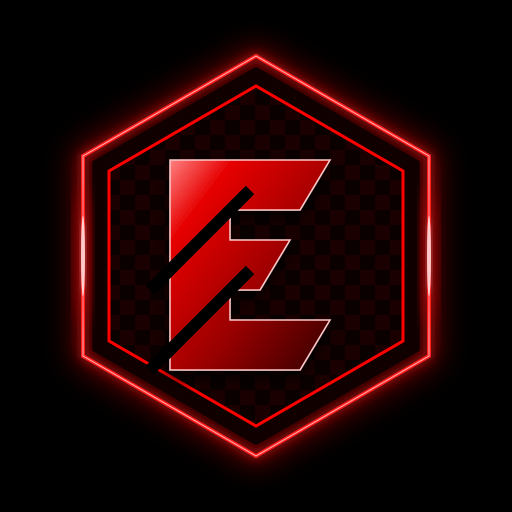

# 🌌 EnigmaOS — Windows Edition

<p align="center">
  
</p>

<h1 align="center">EnigmaOS (Windows Edition)</h1>

<p align="center">
  <strong>Entorno de sobrecubierta cibernético de última generación, Dynamic Island flotante, Dock inteligente con sustitución nativa de barra de tareas (estilo Seelen UI) y Asistente de IA multimodal 100% local para Windows 10 y 11.</strong>
</p>

<p align="center">
  <a href="https://github.com/mortalpirata107/EnigmaWindows/releases/latest"></a>
  
  
  
  
  
  
  
</p>

---

## ⚡ Descargas Oficiales para Windows (Versión Más Reciente)

Instala **EnigmaOS** con un solo clic en tu equipo con Windows 10 o Windows 11 de 64 bits:

<div align="center">

### 🪟 Paquetes de Instalación Oficiales (64 bits)

[-0078D6?style=for-the-badge&logo=windows&logoColor=white)](https://github.com/mortalpirata107/EnigmaWindows/releases/latest/download/EnigmaOS_1.0.0_x64-setup.exe)
&nbsp;&nbsp;&nbsp;&nbsp;
[-005A9E?style=for-the-badge&logo=windows&logoColor=white)](https://github.com/mortalpirata107/EnigmaWindows/releases/latest/download/EnigmaOS_1.0.0_x64_en-US.msi)

<br/>

**[👉 Ver el historial completo de versiones, notas de lanzamiento y assets en GitHub Releases](https://github.com/mortalpirata107/EnigmaWindows/releases)**

</div>

| Archivo | Tipo de Instalador | Arquitectura | Compatibilidad | Descarga Directa |
| :--- | :--- | :--- | :--- | :--- |
| **`EnigmaOS_x64-setup.exe`** | Asistente NSIS interactivo | `x86_64` (64-bit) | Windows 10 / Windows 11 | [📥 **Descargar .exe**](https://github.com/mortalpirata107/EnigmaWindows/releases/latest/download/EnigmaOS_1.0.0_x64-setup.exe) |
| **`EnigmaOS_x64_en-US.msi`** | Windows Installer Package | `x86_64` (64-bit) | Windows 10 / Windows 11 | [📥 **Descargar .msi**](https://github.com/mortalpirata107/EnigmaWindows/releases/latest/download/EnigmaOS_1.0.0_x64_en-US.msi) |

> [!TIP]
> **Descarga Siempre Actualizada:** Los botones y enlaces anteriores usan el endpoint `/releases/latest/download/`, descargando permanentemente la compilación más reciente y estable publicada por GitHub Actions.

---

## 🚀 Novedades de la Edición Windows

### 1. 🪟 Sustitución de la Barra de Tareas de Windows (Modo Seelen UI)
- **Sustitución Completa:** Enigma Dock se integra a nivel de API Win32 (`FindWindowW`, `ShowWindow`, `SW_HIDE`/`SW_SHOW` en `Shell_TrayWnd` y `Shell_SecondaryTrayWnd`) para reemplazar de forma limpia la barra de tareas por defecto de Windows.
- **Botón de Alternancia Rápida:** Conmutador dedicado en el Dock para mostrar u ocultar la barra de Windows al instante.
- **Restauración Segura:** Al salir de EnigmaOS, la barra de tareas nativa de Windows se restaura automáticamente.

### 2. ⚡ Detección de Apps 100% Real del Sistema
- **Inspección de Procesos en Tiempo Real:** Detección de procesos mediante `GetWindowThreadProcessId` + `QueryFullProcessImageNameW`. Identifica con precisión Opera, Chrome, Edge, Spotify, Discord, VS Code, Explorer y juegos sin confundir ventanas hijas.
- **Explorador del Menú Inicio:** El lanzador explora en profundidad los accesos directos `.lnk` de `%ProgramData%\Microsoft\Windows\Start Menu\Programs` y `%APPDATA%\Microsoft\Windows\Start Menu\Programs`, permitiendo buscar y ejecutar cualquier aplicación instalada.
- **Control Activo:** Hacer clic en una app abierta la enfoca usando `AttachThreadInput` para superar las restricciones de foco de Windows; si ya está en primer plano, la minimiza como la barra nativa.

### 3. 🏝️ Islas Flotantes con Espacio Superior Limpio y Transparente
- **Margen Superior de 14px:** Posicionamiento flotante calibrado que deja visible el fondo de escritorio sobre el TopBar.
- **Sombra Neumórfica sin Manchas:** Sombras proyectadas con sesgo inferior negativo que evitan cualquier dispersión negra hacia el borde superior de la pantalla.

### 4. 🎯 Desacoplamiento Total de Eventos Notch ⇄ Dock
- **Eventos Dirigidos por Ventana:** Los eventos de cursor de hardware (`dock_cursor_entered`, `main_cursor_entered`) están aislados por etiqueta de ventana. Pasar el ratón por el Notch superior **nunca** abrirá el Dock inferior accidentalmente.

---

## 🧠 Guía de Modelos de Inteligencia Artificial (Ollama Local)

EnigmaOS integra **[Ollama](https://ollama.com/)** para ejecutar modelos de lenguaje y visión multimodales **100% en local, privados y con aceleración por GPU**.

### 1. Instalación de Ollama en Windows
Ejecuta en PowerShell con Windows Package Manager (`winget`):
```powershell
winget install Ollama.Ollama
```
O descarga el instalador oficial desde **[ollama.com/download/windows](https://ollama.com/download/windows)**.

---

### 2. Tabla de Requisitos de Hardware y Arquitecturas GPU

EnigmaOS está optimizado para exprimir al máximo tu hardware, desde equipos portátiles modestos hasta las nuevas tarjetas **NVIDIA GeForce RTX Serie 50 (Blackwell)**:

| Nivel de Hardware | Tarjetas Gráficas y Requisitos | Rendimiento | Modelo Principal (Chat & Razonamiento) | Modelo de Programación | Modelo de Visión |
| :--- | :--- | :--- | :--- | :--- | :--- |
| **Básico (CPU / Ligero)** | CPU moderna · 4 a 8 GB de RAM · Gráficos integrados (Intel Iris / AMD Radeon) | Fluido y ágil en cualquier portátil | `llama3.2:1b` | `qwen2.5-coder:1.5b` | `moondream` |
| **Equilibrado (Recomendado)** | 16 GB RAM · GPU con 6–8 GB VRAM (RTX 2060, 3060, 4060 o AMD RX 6600/7600) | Excelente tiempo de respuesta y análisis diario | `llama3.2:3b` | `qwen2.5-coder:7b` | `llava:7b` |
| **Pro / Avanzado** | 32 GB RAM · GPU con 12–16 GB VRAM (RTX 3080/3090, RTX 4070/4080) | Razonamiento profundo y generación de código complejo | `hermes3:8b` + `deepseek-r1:14b` | `qwen2.5-coder:14b` | `llava:13b` |
| **🚀 Ultra / Blackwell (NVIDIA RTX 50 Series)** | **NVIDIA GeForce RTX 5090 (32 GB)**<br/>**RTX 5080 (16 GB)**<br/>**RTX 5070 Ti (16 GB)**<br/>**RTX 5070 (12 GB)** | **Inferencia ultrarrápida con Tensor Cores Blackwell de 5.ª Gen y soporte FP4/FP8** | `deepseek-r1:32b` o `llama3.3:70b-instruct-q4_K_M` | `qwen2.5-coder:32b` | `llava:13b` |

---

### 3. Comandos de Descarga de Modelos según tu Tarjeta

Abre tu terminal de PowerShell y descarga el lote correspondiente a tu GPU:

#### 🟢 Nivel NVIDIA RTX Serie 50 (Blackwell: RTX 5090 / 5080 / 5070 Ti / 5070)
```powershell
# Modelo de razonamiento profundo con inferencia acelerada Blackwell
ollama pull deepseek-r1:32b

# Modelo de desarrollo y arquitectura de software de alta gama
ollama pull qwen2.5-coder:32b

# Modelo multimodal de visión de alta fidelidad para capturas de pantalla
ollama pull llava:13b
```

#### 🔵 Nivel Pro (NVIDIA RTX Serie 40 y 30: RTX 4090 / 4080 / 4070 / 3090 / 3080)
```powershell
ollama pull hermes3:8b
ollama pull deepseek-r1:14b
ollama pull qwen2.5-coder:7b
ollama pull llava:7b
```

#### 🟡 Nivel Equilibrado (NVIDIA RTX 4060 / 3060 / 2060 o AMD Radeon)
```powershell
ollama pull llama3.2:3b
ollama pull qwen2.5-coder:7b
ollama pull llava:7b
```

#### ⚪ Nivel Básico (Solo CPU o Laptops sin GPU dedicada)
```powershell
ollama pull llama3.2:1b
ollama pull moondream
```

---

### 4. Personalización de Modelos (`models.json`)

EnigmaOS guarda la asignación de modelos en un archivo JSON ubicado en:
📁 `%APPDATA%\enigmaos\models.json`

Ejemplo para aprovechar la **Serie RTX 50 de NVIDIA**:
```json
{
  "preset": "blackwell_ultra",
  "orchestrator_model": "deepseek-r1:32b",
  "system_model": "hermes3:8b",
  "code_model": "qwen2.5-coder:32b",
  "reasoning_model": "deepseek-r1:32b",
  "general_model": "llama3.3:70b-instruct-q4_K_M",
  "vision_model": "llava:13b",
  "default_model": "deepseek-r1:32b"
}
```

> [!TIP]
> **Tolerancia a Fallos:** Si configuras un modelo que no está descargado, EnigmaOS consulta dinámicamente tu instancia local de Ollama y conmuta de forma transparente al mejor modelo disponible.

---

## ⌨️ Atajos de Teclado Globales en Windows

| Atajo | Función |
| :--- | :--- |
| **`Alt + Espacio`** | Abre / Cierra el Lanzador Universal Spotlight (búsqueda de apps, archivos y cálculos) |
| **`Alt + V`** | Abre / Cierra el Portapapeles Inteligente con previsualización de capturas y código |
| **`Alt + 3`** | Despliega el Asistente Enigma AI con VoiceOrb 3D y panel Bento |
| **`Win + Ctrl + Flecha Izq / Der`** | Cambia de Escritorio Virtual nativo en Windows 10 y 11 |
| **`Esc`** | Cierra cualquier modal o buscador activo y repliega el Notch |

---

## 🛠️ Compilación desde el Código Fuente

Si deseas compilar EnigmaOS localmente:

### Requisitos
1. **Node.js:** v18+ o v20+ con `npm`.
2. **Rust & Cargo:** Versión estable (`https://rustup.rs`).
3. **Carga de trabajo MSVC:** Visual Studio 2022 con *Desarrollo para el escritorio con C++*.
4. **WebView2 Runtime:** Incluido por defecto en Windows 10 y 11.

### Pasos de Compilación
```powershell
# 1. Clonar el repositorio
git clone https://github.com/mortalpirata107/EnigmaWindows.git
cd EnigmaWindows

# 2. Instalar dependencias web
npm install

# 3. Compilar frontend de producción
npm run build

# 4. Ejecutar en modo desarrollo con Hot-Reload
npx tauri dev

# 5. Generar los instaladores de producción (.exe y .msi)
npx tauri build
```
Los archivos compilados se generarán en `src-tauri/target/release/bundle/nsis/` (`.exe`) y `src-tauri/target/release/bundle/msi/` (`.msi`).

---

## 📂 Directorios de Datos en Windows

- **Base de Datos SQLite:** `%LOCALAPPDATA%\enigmaos\enigma.db`
- **Configuración de Modelos:** `%APPDATA%\enigmaos\models.json`
- **Configuración del Dock:** `%APPDATA%\enigmaos\dock.json`

---

## 📄 Licencia

Distribuido bajo la Licencia **MIT**. Desarrollado para Windows 10 y Windows 11.
